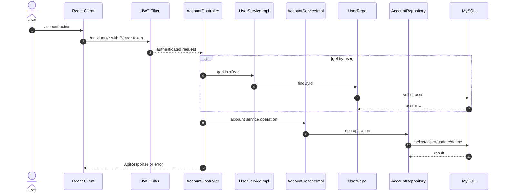

# Account API Manager Design (2026-04-17)

## 1. Purpose

Define `ACCOUNT_API_MGR` for account list/create/update/delete operations with contracts and execution flow.

## 2. Scope

Controller scope:
- `GET /accounts/user/{userId}`
- `POST /accounts/add`
- `PUT /accounts/update/{id}`
- `DELETE /accounts/delete/{id}`

## 3. Runtime Modules

- API Manager: `AccountController`
- SRVA: `AccountServiceImpl`, `UserServiceImpl`
- WF: `AccountRepository`, `UserRepo`
- Shared error modules: `GlobalExceptionHandler` (partial), default Spring error handling

## 4. Manager Function Index

| Function | part-id | module-id | requestKey | Inputs |
|---|---|---|---|---|
| `getAccountsByUser` | `PART-ACC-001` | `MOD-ACC-CTRL-001` | `GET:/accounts/user/{userId}` | `path userId: Long` |
| `addAccount` | `PART-ACC-002` | `MOD-ACC-CTRL-002` | `POST:/accounts/add` | `body: Account entity` |
| `updateAccount` | `PART-ACC-003` | `MOD-ACC-CTRL-003` | `PUT:/accounts/update/{id}` | `path id: Long`, `body: Account entity` |
| `deleteAccount` | `PART-ACC-004` | `MOD-ACC-CTRL-004` | `DELETE:/accounts/delete/{id}` | `path id: Long` |

## 5. Manager Sequence (Double Click)



## 6. SRVA Function-Level Detail

### 6.1 `getAccountsByUser`

- part-id: `PART-ACC-001`
- module-id: `MOD-ACC-CTRL-001`
- requestKey: `GET:/accounts/user/{userId}`
- input contract:
  - path `userId: Long`
- SRVA calls:
  - `SRVA-USER-201`: `UserService.getUserById`
  - `SRVA-ACC-001`: `AccountServiceImpl.getAccountsByUser`
- WF calls:
  - `WF-USER-201`: `UserRepo.findById`
  - `WF-ACC-001`: `AccountRepository.findByUser`
- steps:
  1. Resolve user by id.
  2. Find accounts bound to user.
  3. Map to `AccountResponse`.
  4. Return `ApiResponse<List<AccountResponse>>`.
- `handleOk` payload contract:

```json
{
  "status": "success",
  "message": "Accounts fetched successfully",
  "data": [
    {
      "id": 1,
      "accountName": "Cash",
      "type": "Asset",
      "balance": 1000.0,
      "userId": 1
    }
  ]
}
```

- `handleError` payload contract:

```json
{
  "status": "failure",
  "type": "User Exception",
  "error": "User not found",
  "localTime": "ISO-like local timestamp",
  "httpStatus": "INTERNAL_SERVER_ERROR"
}
```

### 6.2 `addAccount`

- part-id: `PART-ACC-002`
- module-id: `MOD-ACC-CTRL-002`
- requestKey: `POST:/accounts/add`
- input contract:
  - body `Account` entity:
    - `accountName: String`
    - `type: String` (`Asset`/`Liability`)
    - `balance: Double`
    - `user: User` (required by JPA mapping)
- SRVA calls:
  - `SRVA-ACC-002`: `AccountServiceImpl.addAccount`
- WF calls:
  - `WF-ACC-002`: `AccountRepository.save`
- steps:
  1. Receive account entity payload.
  2. Persist through account repository.
  3. Return saved account in `ApiResponse`.
- `handleOk` payload contract:

```json
{
  "status": "success",
  "message": "Account added",
  "data": {
    "id": 1,
    "accountName": "Cash",
    "type": "Asset",
    "balance": 1000.0,
    "user": { "id": 1 }
  }
}
```

- `handleError` payload contract:
  - validation/JPA/runtime issues currently surface as default Spring error payload.

### 6.3 `updateAccount`

- part-id: `PART-ACC-003`
- module-id: `MOD-ACC-CTRL-003`
- requestKey: `PUT:/accounts/update/{id}`
- input contract:
  - path `id: Long`
  - body `Account` entity (mutable fields used: `accountName`, `type`, `balance`)
- SRVA calls:
  - `SRVA-ACC-003`: `AccountServiceImpl.updateAccount`
- WF calls:
  - `WF-ACC-003`: `AccountRepository.findById`
  - `WF-ACC-004`: `AccountRepository.save`
- steps:
  1. Resolve existing account by id.
  2. Copy mutable fields.
  3. Save and return updated account.
- `handleOk` payload contract:

```json
{
  "status": "success",
  "message": "Account updated",
  "data": {
    "id": 1,
    "accountName": "Bank",
    "type": "Asset",
    "balance": 1200.0
  }
}
```

- `handleError` payload contract:
  - if account not found, `RuntimeException("Account not found")` -> default Spring error payload.

### 6.4 `deleteAccount`

- part-id: `PART-ACC-004`
- module-id: `MOD-ACC-CTRL-004`
- requestKey: `DELETE:/accounts/delete/{id}`
- input contract:
  - path `id: Long`
- SRVA calls:
  - `SRVA-ACC-004`: `AccountServiceImpl.deleteAccount`
- WF calls:
  - `WF-ACC-003`: `AccountRepository.findById`
  - `WF-ACC-005`: `AccountRepository.delete`
- steps:
  1. Resolve account by id.
  2. Delete entity.
  3. Return success envelope.
- `handleOk` payload contract:

```json
{
  "status": "success",
  "message": "Account deleted successfully",
  "data": null
}
```

- `handleError` payload contract:
  - runtime not-found or DB exceptions are not normalized by current global handler.

## 7. Review + Improve Notes

- Replace raw `Account` body contract with `AccountCreateRequest`/`AccountUpdateRequest` DTOs.
- Add explicit not-found exception class for accounts and map with global handler.
- Enforce authenticated user ownership checks for account update/delete routes.

