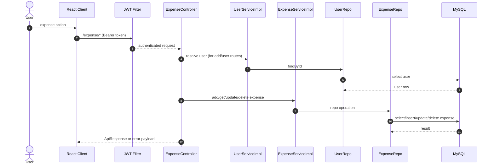

# Expense API Manager Design (2026-04-17)

## 1. Purpose

Define `EXPENSE_API_MGR` behavior for expense CRUD/list operations with SRVA and WF contract details.

## 2. Scope

Controller scope:
- `POST /expense/add`
- `GET /expense/all`
- `GET /expense/user/{userId}`
- `PUT /expense/update`
- `DELETE /expense/delete/{id}`

## 3. Runtime Modules

- API Manager: `ExpenseController`
- SRVA: `ExpenseServiceImpl`, `UserServiceImpl`
- WF: `ExpenseRepo`, `UserRepo`
- Shared error module: `GlobalExceptionHandler`

## 4. Manager Function Index

| Function | part-id | module-id | requestKey | Inputs |
|---|---|---|---|---|
| `addExpense` | `PART-EXP-001` | `MOD-EXP-CTRL-001` | `POST:/expense/add` | `body: ExpenseAddRequest` |
| `getAllExpenses` | `PART-EXP-002` | `MOD-EXP-CTRL-002` | `GET:/expense/all` | none |
| `getExpensesByUser` | `PART-EXP-003` | `MOD-EXP-CTRL-003` | `GET:/expense/user/{userId}` | `path userId: Long` |
| `updateExpense` | `PART-EXP-004` | `MOD-EXP-CTRL-004` | `PUT:/expense/update` | `body: ExpenseUpdateRequest` |
| `deleteExpense` | `PART-EXP-005` | `MOD-EXP-CTRL-005` | `DELETE:/expense/delete/{id}` | `path id: Long` |

## 5. Manager Sequence (Double Click)



## 6. SRVA Function-Level Detail

### 6.1 `addExpense`

- part-id: `PART-EXP-001`
- module-id: `MOD-EXP-CTRL-001`
- requestKey: `POST:/expense/add`
- input contract:
  - `ExpenseAddRequest { amount:number, category:string, description?:string, account?:string, date:LocalDate, userId:number }`
- SRVA calls:
  - `SRVA-USER-101`: `UserService.getUserById`
  - `SRVA-EXP-001`: `ExpenseService.addExpense`
- WF calls:
  - `WF-USER-101`: `UserRepo.findById`
  - `WF-EXP-001`: `ExpenseRepo.save`
- steps:
  1. Validate request (`@Valid`).
  2. Resolve user by `userId`.
  3. Build `Expense` entity and attach user.
  4. Persist expense.
  5. Map to `ExpenseResponse` and wrap in `ApiResponse`.
- `handleOk` payload contract:

```json
{
  "status": "success",
  "message": "Expense added",
  "data": {
    "id": 1,
    "amount": 100.0,
    "category": "Food",
    "description": "string",
    "date": "2026-04-17",
    "account": "CASH",
    "userId": 1
  }
}
```

- `handleError` payload contract:
  - user not found (mapped by `UserException`):

```json
{
  "status": "failure",
  "type": "User Exception",
  "error": "User not found",
  "localTime": "ISO-like local timestamp",
  "httpStatus": "INTERNAL_SERVER_ERROR"
}
```

### 6.2 `getAllExpenses`

- part-id: `PART-EXP-002`
- module-id: `MOD-EXP-CTRL-002`
- requestKey: `GET:/expense/all`
- input contract:
  - none
- SRVA calls:
  - `SRVA-EXP-002`: `ExpenseService.getAllExpenses`
- WF calls:
  - `WF-EXP-002`: `ExpenseRepo.findAll`
- steps:
  1. Fetch all expense entities.
  2. Map each entity to `ExpenseResponse`.
  3. Return `ApiResponse<List<ExpenseResponse>>`.
- `handleOk` payload contract:

```json
{
  "status": "success",
  "message": "All expenses",
  "data": [
    {
      "id": 1,
      "amount": 100.0,
      "category": "Food",
      "description": "string",
      "date": "2026-04-17",
      "account": "CASH",
      "userId": 1
    }
  ]
}
```

- `handleError` payload contract:
  - default Spring error envelope for unexpected runtime failures.

### 6.3 `getExpensesByUser`

- part-id: `PART-EXP-003`
- module-id: `MOD-EXP-CTRL-003`
- requestKey: `GET:/expense/user/{userId}`
- input contract:
  - path `userId: Long`
- SRVA calls:
  - `SRVA-USER-101`: `UserService.getUserById`
  - `SRVA-EXP-003`: `ExpenseService.getExpensesByUser`
- WF calls:
  - `WF-USER-101`: `UserRepo.findById`
  - `WF-EXP-003`: `ExpenseRepo.findByUser`
- steps:
  1. Resolve user.
  2. Load expenses by user.
  3. Map and return list response.
- `handleOk` payload contract:

```json
{
  "status": "success",
  "message": "Expenses by user",
  "data": [
    {
      "id": 1,
      "amount": 100.0,
      "category": "Food",
      "description": "string",
      "date": "2026-04-17",
      "account": "CASH",
      "userId": 1
    }
  ]
}
```

- `handleError` payload contract:
  - same `UserException` envelope for missing user.

### 6.4 `updateExpense`

- part-id: `PART-EXP-004`
- module-id: `MOD-EXP-CTRL-004`
- requestKey: `PUT:/expense/update`
- input contract:
  - `ExpenseUpdateRequest { id:number, amount:number, category:string, description?:string, account?:string, date:LocalDate }`
- SRVA calls:
  - `SRVA-EXP-004`: `ExpenseService.getExpenseById`
  - `SRVA-EXP-005`: `ExpenseService.updateExpense`
- WF calls:
  - `WF-EXP-004`: `ExpenseRepo.findById`
  - `WF-EXP-005`: `ExpenseRepo.save`
- steps:
  1. Resolve expense by id.
  2. Apply mutable fields.
  3. Persist updated record.
  4. Map to `ExpenseResponse`.
- `handleOk` payload contract:

```json
{
  "status": "success",
  "message": "Expense updated",
  "data": {
    "id": 1,
    "amount": 120.0,
    "category": "Food",
    "description": "string",
    "date": "2026-04-17",
    "account": "CASH",
    "userId": 1
  }
}
```

- `handleError` payload contract:
  - expense-not-found currently uses `UserException("Expense not found", null)`:

```json
{
  "status": "failure",
  "type": "User Exception",
  "error": "Expense not found",
  "localTime": "ISO-like local timestamp",
  "httpStatus": "INTERNAL_SERVER_ERROR"
}
```

### 6.5 `deleteExpense`

- part-id: `PART-EXP-005`
- module-id: `MOD-EXP-CTRL-005`
- requestKey: `DELETE:/expense/delete/{id}`
- input contract:
  - path `id: Long`
- SRVA calls:
  - `SRVA-EXP-006`: `ExpenseService.deleteExpense`
- WF calls:
  - `WF-EXP-006`: `ExpenseRepo.deleteById`
- steps:
  1. Delete by id.
  2. Return success envelope.
- `handleOk` payload contract:

```json
{
  "status": "success",
  "message": "Expense deleted",
  "data": null
}
```

- `handleError` payload contract:
  - if delete fails unexpectedly, default Spring error envelope.

## 7. Review + Improve Notes

- `Expense` entity field name is `Account` (capital A), while DTO uses `account`; align naming.
- replace `UserException(..., null)` with explicit `ExpenseException` status codes.
- add ownership validation: user can only update/delete own expense.

