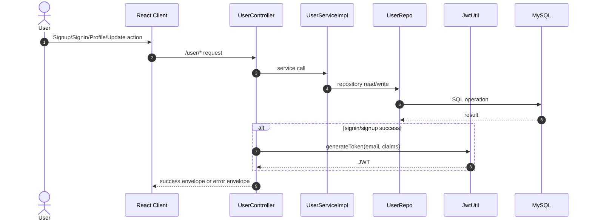

# User API Manager Design (2026-04-17)

## 1. Purpose

Define `USER_API_MGR` with:
- route and function index
- contract shapes
- SRVA and WF execution flow
- per-function `handleOk` and `handleError` payload contracts

## 2. Scope

Controller scope:
- `POST /user/signup`
- `POST /user/signin`
- `GET /user/profile/{userId}`
- `PUT /user/update/{userId}`

## 3. Runtime Modules

- API Manager: `UserController`
- SRVA: `UserServiceImpl`
- WF: `UserRepo`, `PasswordEncoder`, `JwtUtil`
- Shared error module: `GlobalExceptionHandler`

## 4. Manager Function Index

| Function | part-id | module-id | requestKey | Inputs |
|---|---|---|---|---|
| `userSignUp` | `PART-AUTH-001` | `MOD-USER-CTRL-001` | `POST:/user/signup` | `body: UserSignupRequest` |
| `userSignIn` | `PART-AUTH-002` | `MOD-USER-CTRL-002` | `POST:/user/signin` | `body: UserSignInRequest` |
| `getUserProfile` | `PART-USER-003` | `MOD-USER-CTRL-003` | `GET:/user/profile/{userId}` | `path userId: Long` |
| `updateUser` | `PART-USER-004` | `MOD-USER-CTRL-004` | `PUT:/user/update/{userId}` | `path userId: Long`, `body: UserUpdateRequest` |

## 5. Manager Sequence (Double Click)



## 6. SRVA Function-Level Detail

### 6.1 `userSignUp`

- part-id: `PART-AUTH-001`
- module-id: `MOD-USER-CTRL-001`
- requestKey: `POST:/user/signup`
- input contract:
  - `UserSignupRequest { name:string, email:string, password:string, profileImgUrl?:string, profileImgUrlPublicId?:string }`
- SRVA calls:
  - `SRVA-USER-001`: `UserService.getUserByEmail(email)`
  - `SRVA-USER-002`: `UserService.saveUser(user)`
- WF calls:
  - `WF-USER-001`: `UserRepo.findByEmail`
  - `WF-USER-002`: `PasswordEncoder.encode`
  - `WF-USER-003`: `UserRepo.save`
  - `WF-AUTH-001`: `JwtUtil.generateToken`
- steps:
  1. Validate request via `@Valid` + `BindingResult`.
  2. Reject if email already exists.
  3. Encode password and save user.
  4. Build JWT claims (`email`, `role`, `userId`), generate token.
  5. Return auth payload.
- `handleOk` payload contract:

```json
{
  "status": "success",
  "message": "Account created successfully",
  "userId": 1,
  "token": "jwt-token",
  "profileImgUrl": "string|null"
}
```

- `handleError` payload contract:
  - Validation or business error:

```json
{
  "status": "failure",
  "type": "User Exception",
  "error": "Invalid User Input | Email already exists",
  "localTime": "ISO-like local timestamp",
  "httpStatus": "BAD_REQUEST | CONFLICT"
}
```

### 6.2 `userSignIn`

- part-id: `PART-AUTH-002`
- module-id: `MOD-USER-CTRL-002`
- requestKey: `POST:/user/signin`
- input contract:
  - `UserSignInRequest { email:string, password:string }`
- SRVA calls:
  - `SRVA-USER-003`: `UserService.getUserByEmail(email)`
- WF calls:
  - `WF-USER-001`: `UserRepo.findByEmail`
  - `WF-USER-004`: `PasswordEncoder.matches`
  - `WF-AUTH-001`: `JwtUtil.generateToken`
- steps:
  1. Validate request.
  2. Resolve user by email.
  3. Verify password.
  4. Generate JWT with claims.
  5. Return auth payload.
- `handleOk` payload contract:

```json
{
  "status": "success",
  "message": "Logged in successfully",
  "userId": 1,
  "token": "jwt-token",
  "profileImgUrl": "string|null"
}
```

- `handleError` payload contract:

```json
{
  "status": "failure",
  "type": "User Exception",
  "error": "Invalid User Input | Email not found | Invalid password",
  "localTime": "ISO-like local timestamp",
  "httpStatus": "BAD_REQUEST | NOT_FOUND | UNAUTHORIZED"
}
```

### 6.3 `getUserProfile`

- part-id: `PART-USER-003`
- module-id: `MOD-USER-CTRL-003`
- requestKey: `GET:/user/profile/{userId}`
- input contract:
  - path `userId: Long`
  - auth: required Bearer token
- SRVA calls:
  - `SRVA-USER-004`: `UserService.getUserById(userId)`
- WF calls:
  - `WF-USER-005`: `UserRepo.findById`
- steps:
  1. Resolve user by id.
  2. Map to `UserResponse`.
  3. Wrap in `ApiResponse<UserResponse>`.
- `handleOk` payload contract:

```json
{
  "status": "success",
  "message": "Profile data",
  "data": {
    "id": 1,
    "name": "string",
    "email": "string",
    "role": "USER",
    "profileImgUrl": "string|null",
    "profileImgUrlPublicId": "string|null"
  }
}
```

- `handleError` payload contract:

```json
{
  "status": "failure",
  "type": "User Exception",
  "error": "User not found",
  "localTime": "ISO-like local timestamp",
  "httpStatus": "NOT_FOUND"
}
```

### 6.4 `updateUser`

- part-id: `PART-USER-004`
- module-id: `MOD-USER-CTRL-004`
- requestKey: `PUT:/user/update/{userId}`
- input contract:
  - path `userId: Long`
  - body `UserUpdateRequest`
- SRVA calls:
  - `SRVA-USER-004`: `UserService.getUserById(userId)`
  - `SRVA-USER-002`: `UserService.saveUser(user)`
- WF calls:
  - `WF-USER-005`: `UserRepo.findById`
  - `WF-USER-002`: `PasswordEncoder.encode` (only if password present)
  - `WF-USER-003`: `UserRepo.save`
- steps:
  1. Resolve path userId.
  2. Update editable fields.
  3. Re-encode password if non-empty.
  4. Save and return mapped `UserResponse`.
- `handleOk` payload contract:

```json
{
  "status": "success",
  "message": "Profile updated",
  "data": {
    "id": 1,
    "name": "string",
    "email": "string",
    "role": "USER",
    "profileImgUrl": "string|null",
    "profileImgUrlPublicId": "string|null"
  }
}
```

- `handleError` payload contract:

```json
{
  "status": "failure",
  "type": "User Exception",
  "error": "User not found",
  "localTime": "ISO-like local timestamp",
  "httpStatus": "NOT_FOUND"
}
```

## 7. Review + Improve Notes

- `UserUpdateRequest.id` is currently redundant because path `userId` is used.
- Token generation has no explicit expiry claim (`exp`).
- Consider central `AuthResponse` DTO to avoid map-based response drift.

