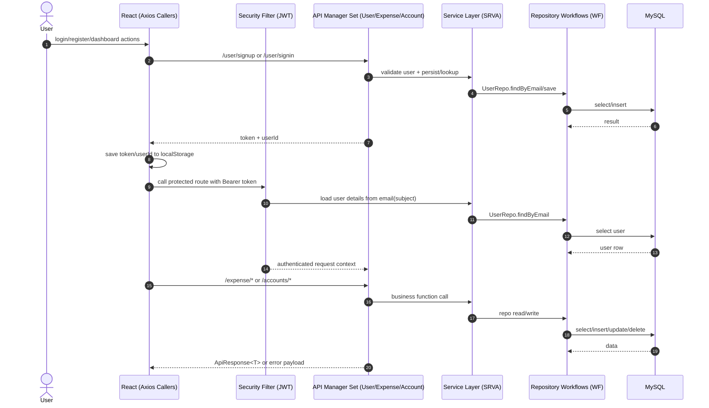

# Finora API System Design (2026-04-17)

## 1. Purpose

Document the runtime API design of `Finora(springboot+react)` with:
- route index and contracts
- CORS/JWT/auth architecture
- API manager grouping
- SRVA and WF execution flow
- high-level sequence view

## 2. Scope

In scope:
- Spring Boot API modules (`/user`, `/expense`, `/accounts`)
- Security config (`SecurityConfig`, `JwtRequestFilter`, `JwtUtil`)
- Contract DTOs (`request/*`, `response/*`)
- React caller pattern (component-level Axios requests)

Out of scope:
- UI visual design behavior details
- DB schema migrations/history
- deployment infra

## 3. Runtime Modules

- `API Manager Set: USER_API_MGR` (Controller: `UserController`)
  - signup/signin/profile/update endpoints
- `API Manager Set: EXPENSE_API_MGR` (Controller: `ExpenseController`)
  - expense CRUD + list endpoints
- `API Manager Set: ACCOUNT_API_MGR` (Controller: `AccountController`)
  - account CRUD + list endpoints
- `Auth/Security`
  - `SecurityConfig`
  - `JwtRequestFilter`
  - `JwtUtil`
  - `CustomUserDetailsService`
- `SRVA layer`
  - `UserServiceImpl`
  - `ExpenseServiceImpl`
  - `AccountServiceImpl`
- `WF layer`
  - `UserRepo`, `ExpenseRepo`, `AccountRepository`
  - `PasswordEncoder` verification/encoding

## 4. Canonical Type Definitions

### 4.1 Request Contracts

```ts
type UserSignInRequest = {
  email: string; // @Email @NotBlank
  password: string; // @NotBlank
};

type UserSignupRequest = {
  name: string; // @NotBlank
  email: string; // @Email @NotBlank
  password: string; // @NotBlank
  profileImgUrl?: string;
  profileImgUrlPublicId?: string;
};

type UserUpdateRequest = {
  id: number; // @NotNull (currently not used in controller path logic)
  name: string; // @NotBlank
  email: string; // @NotBlank
  password?: string;
  profileImgUrl?: string;
};

type ExpenseAddRequest = {
  amount: number; // @NotNull @Min(0)
  category: string; // @NotBlank
  description?: string;
  account?: string;
  date: string; // LocalDate
  userId: number; // @NotNull
};

type ExpenseUpdateRequest = {
  id: number; // @NotNull
  amount: number; // @NotNull @Min(0)
  category: string; // @NotBlank
  description?: string;
  account?: string;
  date: string; // LocalDate
};
```

### 4.2 Success Envelope Contracts

```ts
type ApiResponse<T> = {
  status: string; // usually "success"
  message: string;
  data: T;
};

type UserAuthSuccess = {
  status: "success";
  message: string;
  userId: number;
  token: string;
  profileImgUrl?: string | null;
};

type ErrorEnvelope = {
  status: "failure";
  type: string;
  error: string;
  localTime: string;
  httpStatus: string;
};
```

### 4.3 Error Surface Notes

- `UserException` and `ExpenseException` are normalized by `GlobalExceptionHandler`.
- `RuntimeException` thrown in account/expense SRVA paths currently falls through to default Spring error payload (not `ErrorEnvelope`).

## 5. API Manager Index

Part/Module ID convention:
- `PART-*`: functional domain
- `MOD-*`: implementation module
- `SRVA-*`: service adapter function
- `WF-*`: workflow/repository function

`requestKey` convention in this document:
- `METHOD:/path` (doc-level canonical key for tracing; not a runtime header key)

| Function | part-id | module-id | api-mgr-set | requestKey | Input params/contracts |
|---|---|---|---|---|---|
| `userSignUp` | `PART-AUTH-001` | `MOD-USER-CTRL-001` | `USER_API_MGR` | `POST:/user/signup` | body: `UserSignupRequest` |
| `userSignIn` | `PART-AUTH-002` | `MOD-USER-CTRL-002` | `USER_API_MGR` | `POST:/user/signin` | body: `UserSignInRequest` |
| `getUserProfile` | `PART-USER-003` | `MOD-USER-CTRL-003` | `USER_API_MGR` | `GET:/user/profile/{userId}` | path: `userId: Long` |
| `updateUser` | `PART-USER-004` | `MOD-USER-CTRL-004` | `USER_API_MGR` | `PUT:/user/update/{userId}` | path: `userId: Long`, body: `UserUpdateRequest` |
| `addExpense` | `PART-EXP-001` | `MOD-EXP-CTRL-001` | `EXPENSE_API_MGR` | `POST:/expense/add` | body: `ExpenseAddRequest` |
| `getAllExpenses` | `PART-EXP-002` | `MOD-EXP-CTRL-002` | `EXPENSE_API_MGR` | `GET:/expense/all` | none |
| `getExpensesByUser` | `PART-EXP-003` | `MOD-EXP-CTRL-003` | `EXPENSE_API_MGR` | `GET:/expense/user/{userId}` | path: `userId: Long` |
| `updateExpense` | `PART-EXP-004` | `MOD-EXP-CTRL-004` | `EXPENSE_API_MGR` | `PUT:/expense/update` | body: `ExpenseUpdateRequest` |
| `deleteExpense` | `PART-EXP-005` | `MOD-EXP-CTRL-005` | `EXPENSE_API_MGR` | `DELETE:/expense/delete/{id}` | path: `id: Long` |
| `getAccountsByUser` | `PART-ACC-001` | `MOD-ACC-CTRL-001` | `ACCOUNT_API_MGR` | `GET:/accounts/user/{userId}` | path: `userId: Long` |
| `addAccount` | `PART-ACC-002` | `MOD-ACC-CTRL-002` | `ACCOUNT_API_MGR` | `POST:/accounts/add` | body: `Account` entity |
| `updateAccount` | `PART-ACC-003` | `MOD-ACC-CTRL-003` | `ACCOUNT_API_MGR` | `PUT:/accounts/update/{id}` | path: `id: Long`, body: `Account` entity |
| `deleteAccount` | `PART-ACC-004` | `MOD-ACC-CTRL-004` | `ACCOUNT_API_MGR` | `DELETE:/accounts/delete/{id}` | path: `id: Long` |

## 6. CORS, JWT, Auth, API Manager, Request Keys, SRVA and WF

### 6.1 CORS

- CORS is configured in `SecurityConfig.corsConfigurationSource`.
- Allowed origin is `frontend.url` from backend `.env` (`http://localhost:5173`).
- Methods and headers are wildcard (`*`), credentials allowed.

### 6.2 Auth + JWT

- Public endpoints: `/user/signup`, `/user/signin`.
- Every other route requires authenticated request.
- React passes `Authorization: Bearer <token>`.
- `JwtRequestFilter` extracts token and subject(email), loads `UserDetails`, and sets `SecurityContext`.

### 6.3 API Manager Pattern (Current State)

- Backend manager boundary is controller-level (`UserController`, `ExpenseController`, `AccountController`).
- Frontend does not have a centralized API manager class; Axios calls are distributed across pages/components.
- Document-level `requestKey` is introduced to standardize tracing/review.

### 6.4 SRVA and WF Flow Model

- `SRVA` (service adapter): service implementation functions called by controllers.
- `WF` (workflow): repository calls + security utility steps executed by SRVA/auth modules.

Example:
- `POST:/expense/add`
  - Controller maps request -> `Expense`
  - SRVA: `ExpenseServiceImpl.addExpense`
  - WF: `ExpenseRepo.save` -> DB write

## 7. High-Level Sequence



## 8. Double-Click Deep Dive Docs

- [User API Manager Design](./api-mgr-user-2026-04-17.md)
- [Expense API Manager Design](./api-mgr-expense-2026-04-17.md)
- [Account API Manager Design](./api-mgr-account-2026-04-17.md)

## 9. Improvement Backlog (Review + Improvise)

- Normalize all errors (including `RuntimeException`) into one envelope contract.
- Add token expiry (`exp`) and refresh flow for JWT.
- Introduce centralized frontend `apiManager` wrapper for requestKey + error mapping + auth header injection.
- Align `UserUpdateRequest.id` vs `/{userId}` usage (currently path param drives lookup).
- Add validation for account create/update request DTO instead of exposing raw `Account` entity.

