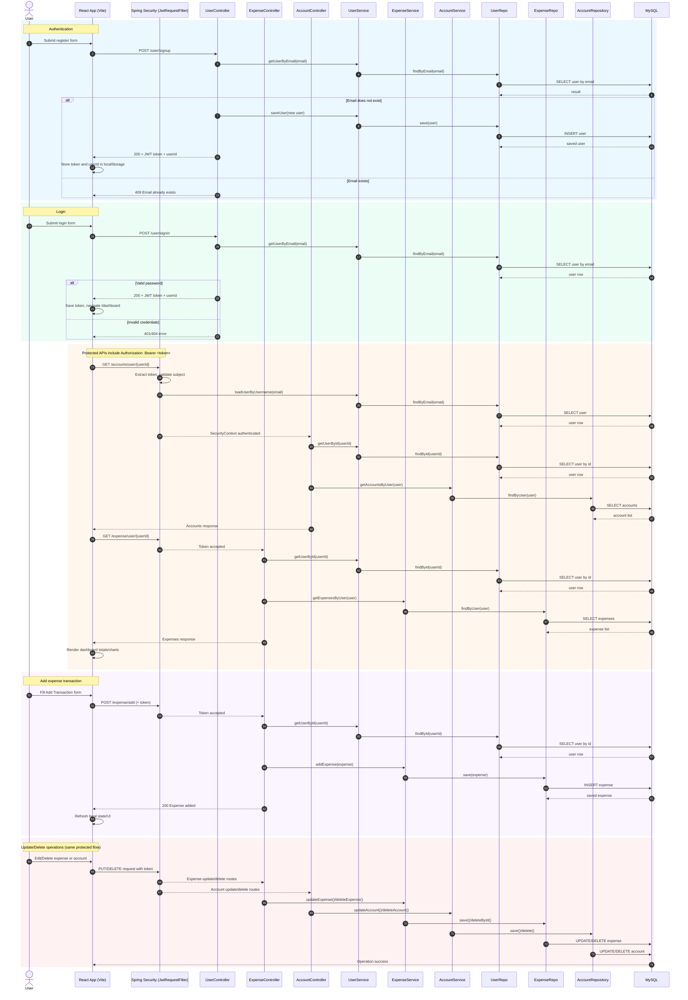

# Finora Project Sequence Diagram

This diagram reflects the current React + Spring Boot + JWT flow in this project.

## Run The Project (Without `.bat` Files)

Open two terminal windows:

1. Spring Boot (backend)

```powershell
cd "C:\Users\ADMIN\Downloads\Finora(springboot+react)\Finora"
.\mvnw.cmd spring-boot:run
```

2. React (frontend)

```powershell
cd "C:\Users\ADMIN\Downloads\Finora(springboot+react)\Finora_react"
npm install
npm run dev
```


